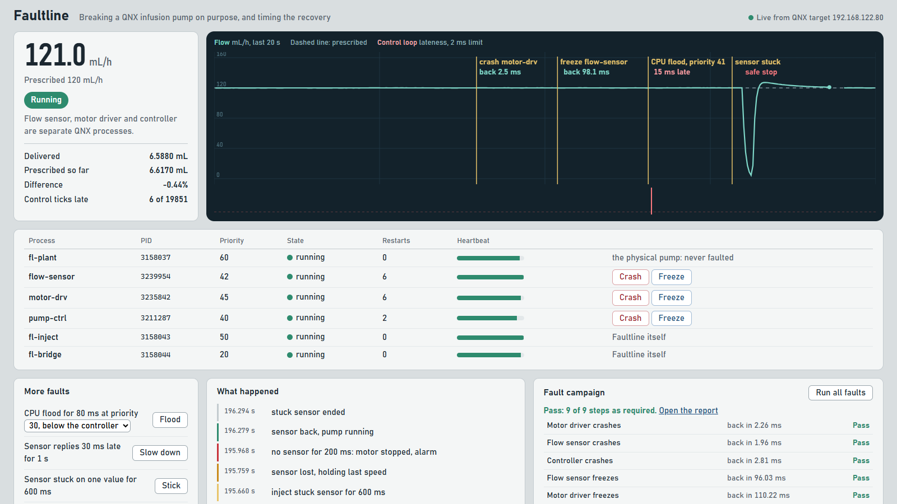

# Faultline

Faultline breaks a running QNX system on purpose, and measures whether it recovers in time.

It crashes processes, freezes them, floods the CPU, slows replies and corrupts readings, while the system keeps running. Each time, it measures four things:

- how fast the failure was noticed
- how fast the process was running again
- whether the real-time loop kept its deadline
- whether the outcome that matters stayed within limits

Then it writes a pass or fail report you can attach to a safety case.

It ships with a reference system to break: a simulated infusion pump made of separate QNX processes.



## What it found

The pump campaign in [`campaigns/pump.json`](campaigns/pump.json) runs nine faults against the pump. This is one run, in QEMU, from [`docs/sample-report.md`](docs/sample-report.md):

| Fault | Noticed | Back in service | Worst control tick late | Pump | Verdict |
| --- | --- | --- | --- | --- | --- |
| Motor driver crashes | 0.53 ms | 2.26 ms | 0 | kept running | Pass |
| Flow sensor crashes | 0.53 ms | 1.96 ms | 0 | kept running | Pass |
| Controller crashes | 0.57 ms | 2.81 ms | 0 | kept running | Pass |
| Flow sensor freezes | 93.6 ms | 96.0 ms | 0 | held its speed | Pass |
| Motor driver freezes | 102.2 ms | 110.2 ms | 0 | kept running | Pass |
| Sensor replies 30 ms late | | | 0 | kept running | Pass |
| CPU flood below the controller's priority | | | 0 | kept running | Pass |
| Sensor stuck on one value | | | 0 | stopped itself at 300 ms | Pass |
| CPU flood above the controller's priority | | | 60.9 ms | held its speed | Caught |

The last row is a check of the checker. A busy task above the controller's priority is supposed to make it miss deadlines, and the step passes only if Faultline catches that.

Two of the things it found were problems in the pump's own design, and both are now fixed:

1. **A frozen server held its client, despite a timeout.**
   - `name_attach()` creates the server's channel with `_NTO_CHF_UNBLOCK`. QNX does this so a server can clean up before a client is released from a reply.
   - So when the flow sensor froze, the controller stayed reply-blocked on it. `TimerTimeout()` couldn't release it, and the 100 Hz loop ran **77 ms late**. `pidin` showed the controller in `REPLY` on the sensor's PID.
   - Fix: the control loop never waits on another process. Two worker threads do the sensor reads and motor writes, and the loop only uses readings fresh enough to trust.
   - With the sensor frozen, the worst tick is now 0 to 3.8 ms late across runs, inside the 5 ms limit.
2. **Crash detection waited for core dumps.**
   - A process killed by `SIGSEGV` goes to `dumper` (priority 10 here) for a core file before its parent can reap it.
   - Detection took about **20 ms**, almost all of it waiting on that.
   - Fix: the supervisor sets `RLIMIT_CORE` to 0 for its children. Set `FL_CORE=1` to keep dumps while debugging.
   - Detection now takes about **0.5 ms**.

## How it works

Everything on the target is C, built with `qcc` from QNX SDP 8.0.

| Process | Priority | Job | QNX features |
| --- | --- | --- | --- |
| `fl-plant` | 60 | The physical pump. Motor inertia, flow and delivered volume, at 1 kHz in shared memory. It is never faulted, because hardware keeps its last command when the software driving it dies. | `timer_create` with `SIGEV_PULSE`, `shm_open` |
| `fl-supervisor` | 55 | Starts every process in [`system.conf`](target/system.conf), notices deaths and missed heartbeats, restarts what failed, and timestamps each step. | `posix_spawn` with `SCHED_FIFO`, `name_attach`, heartbeat pulses, `waitpid` reaper thread, `RLIMIT_CORE` |
| `motor-drv` | 45 | The motor driver. Exposed as `/dev/fl/motor`: write a speed in rpm, read the commanded and actual speed. | resource manager: `resmgr_attach`, `iofunc_*`, `pulse_attach` |
| `flow-sensor` | 42 | Answers flow readings over message passing. | `name_attach`, `MsgReceive`, `MsgReply` |
| `pump-ctrl` | 40 | The 100 Hz control loop. PI control of flow, plus a plausibility check for stuck readings. After 50 ms without a good reading it holds the last speed for up to 200 ms, then stops the motor and raises an alarm. | `name_open`, `MsgSend`, `TimerTimeout`, worker threads |
| `fl-inject` | 50 | Injects faults. Exposed as `/dev/faultline/inject`, so a fault is one `echo` away. | resource manager, `kill`, `SCHED_FIFO` threads |
| `fl-bridge` | 20 | Streams state and events to the dashboard as JSON lines over TCP port 7700, and passes fault commands back in. | sockets |

On the host, [`dashboard/server.py`](dashboard/server.py) and [`dashboard/campaign.py`](dashboard/campaign.py) use only the Python standard library.

- The dashboard draws the flow like a bedside monitor and marks each fault on the trace.
- The campaign runner injects the faults in order, judges each one against the limits in the campaign file, and writes the report as Markdown and HTML.

### Faults

```sh
echo "crash motor-drv"  > /dev/faultline/inject   # SIGSEGV
echo "hang flow-sensor" > /dev/faultline/inject   # SIGSTOP: alive but frozen
echo "flood 41 80"      > /dev/faultline/inject   # one busy SCHED_FIFO thread per CPU at priority 41, for 80 ms
echo "slow 30 1000"     > /dev/faultline/inject   # sensor delays each reply by 30 ms, for 1 s
echo "stuck 600"        > /dev/faultline/inject   # sensor repeats its last value for 600 ms
cat /dev/faultline/inject                         # lists the commands and what can be faulted
```

A rejected fault fails the `write()` with an error: `ENOENT` for an unknown process, `EPERM` for one marked not faultable, and `EBUSY` for one that is already restarting.

### Campaigns

A campaign is a JSON list of faults, each with the limits it must meet:

```json
{ "id": "crash-motor", "title": "Motor driver crashes", "fault": "crash motor-drv",
  "window_ms": 1200, "limits": { "recover_ms": 20, "max_late_ms": 5, "alarm": false, "dose_err_pct": 2 } }
```

| Limit | Meaning |
| --- | --- |
| `recover_ms` | the faulted process is back, meaning it sent its first heartbeat, within this time |
| `max_late_ms` | no control tick starts later than this |
| `alarm` | `false` means the pump must keep running; `true` means it must reach its safe state, within `alarm_within_ms` |
| `dose_err_pct` | the delivered volume over the window stays within this percentage of the prescribed volume |

Set `"expect_fail": true` on a step that should break a limit. That step passes only when the breach is caught.

## Build and run

**You need:**

- **QNX SDP 8.0.** It's free for non-commercial use through [QNX Everywhere](https://www.qnx.com/products/everywhere/). This repo was built with the 8.0.5 patch set.
- **Linux, for the QEMU target.** Ubuntu 22.04 or 24.04, or WSL2 on Windows 11. This repo was developed on WSL2 with Ubuntu 24.04.
- **QEMU and libvirt**, as QNX's QEMU guide asks:
  ```sh
  sudo apt install qemu-system-x86 qemu-utils bridge-utils net-tools libvirt-clients libvirt-daemon-system
  sudo usermod -aG kvm,libvirt $USER    # then log in again
  ~/qnx800/host/common/mkqnximage/qemu/check-net   # lets QEMU use virbr0 (asks for sudo once)
  ```

**Steps:**

```sh
tools/build-target.sh          # builds the target programs with qcc -Vgcc_ntox86_64
tools/make-vm.sh               # builds a QNX 8.0 x86_64 QEMU image in ~/fl-vm (root login by SSH key)
tools/vm.sh start              # boots it headless and waits for SSH
tools/vm.sh deploy             # copies the programs and system.conf to /data/fl on the target
tools/vm.sh run                # starts fl-supervisor, which starts everything else
tools/dash.sh start            # dashboard on http://localhost:8800
tools/dash.sh campaign pump    # or click "Run all faults" on the dashboard
```

Reports are written to `reports/`. To build for a Raspberry Pi instead, use `tools/build-target.sh aarch64le`. That target hasn't been tested.

## Limits

- **Timings in QEMU are approximate.** The emulator doesn't run in real time, and the numbers above come from QEMU with KVM, 4 virtual CPUs, on a laptop. The same build on real hardware should give tighter numbers. Each report records its environment.
- **Hangs take about 100 ms to notice,** because that is the heartbeat deadline set in `system.conf`. A tighter deadline means faster detection, at the cost of more heartbeat traffic.
- **The pump is a simulation,** used to show recovery behaviour. It isn't a medical device and makes no clinical claims.

## License

[MIT](LICENSE)
